<p align="center">
  
</p>

<p align="center"><b>Portfolio:</b> <a href="https://adamtayel.online">adamtayel.online</a> · Alexandria, Egypt</p>

---

## About Me

- **AI Student** at the Arab Academy for Science, Technology & Maritime Transport (AASTMT), Intelligent Systems specialization
- **Dual Degree Program** in collaboration with Universitat Autònoma de Barcelona (UAB)
- **Founder of [Tayel AI Labs](https://tayel.net)**: AI transformation, custom APIs, intelligent chatbots, and migrating legacy stacks to AI-native infrastructure
- Author of **[Tayel AI Labs Courses](https://github.com/Tayel-Ai-Labs-Courses)**: a full open AI engineering curriculum where every printed output is a real run
- Currently researching **value consistency in Large Language Models**
- Currently learning and building:
  - LLMs & Generative AI (Advanced Prompt Engineering, Fine-tuning)
  - RAG Systems and AI Agents
  - Multi-Agent Orchestration and tool-using agents (MCP, Claude Agent SDK)
  - Dynamic Multi-Model Routing for cost and latency optimization
  - Long-term Memory Systems for LLM agents
  - LLM Evaluation, Benchmarking and Alignment
  - Knowledge and Evidence Graphs for personalized learning
  - Quantum Machine Learning
  - AI for Cybersecurity and Reverse Engineering
  - Edge AI and on-device LLMs
- **Languages:** English, Arabic, French, German

---

## Certifications & Training

- **Bachelor in Artificial Intelligence**: Arab Academy for Science & Technology (AASTMT) × UAB
- **[IBM Data Science Professional Certificate](https://coursera.org/verify/professional-cert/6S7LOEAS5RTY)**: IBM
- **Google Prompting Essentials**: Google
- **Foundations of Data Science**: Google
- **Python**: UST
- **Applications of AI**: The British University in Egypt
- **Applications of AI**: Medix
- **[Intro to Generative AI & Prompt Engineering](https://app.manara.tech/certificate/1743611172-77B3FD4AF4D4FE85)**: Manara
- HP LIFE:
  - Cyber Security Awareness
  - Effective Leadership
  - AI for Business Professionals
  - Agile Project Management

---

## Tayel AI Labs Open Courses

[Advanced-AI](https://github.com/Tayel-Ai-Labs-Courses/Advanced-AI) ·
[Mathematics-for-AI](https://github.com/Tayel-Ai-Labs-Courses/Mathematics-for-AI) ·
[Cyber-Ai](https://github.com/Tayel-Ai-Labs-Courses/Cyber-Ai) ·
[Embedded-AI](https://github.com/Tayel-Ai-Labs-Courses/Embedded-AI) ·
[Cloud-Computing](https://github.com/Tayel-Ai-Labs-Courses/Cloud-Computing) ·
[Advanced-Prompt-Engineering](https://github.com/Tayel-Ai-Labs-Courses/Advanced-Prompt-Engineering) ·
[AI-in-Frontend](https://github.com/Tayel-Ai-Labs-Courses/AI-in-Frontend) ·
[AI-in-UIUX](https://github.com/Tayel-Ai-Labs-Courses/AI-in-UIUX) ·
[Claude-Skills](https://github.com/Tayel-Ai-Labs-Courses/Claude-Skills) ·
[Competitive-Programming](https://github.com/Tayel-Ai-Labs-Courses/Competitive-Programming)

---

## Connect with Me

[](https://adamtayel.online)
[](https://www.linkedin.com/in/adam-tayel-54a2bb330/)
[](https://www.upwork.com/freelancers/~01d7ea21a53c6dc390)
[](https://youtube.com/@adamyassertayel)
[](https://www.instagram.com/adamytayel)
[](https://tayel.net)

---

## Languages and Tools

**AI / ML / Deep Learning**


**LLMs, Agents & AI Tools**


**Quantum AI**


**Data Analysis**


**Data Engineering & Databases**


**Languages, Backend & Frontend**


**Robotics, Mechanics & Simulation**


**Embedded & IoT**


**Cloud & DevOps**


**Security & Reverse Engineering**


**Linux & Tooling**


---

## GitHub Stats

<p align="center">
  
  
</p>

---

## Let's Build Together

```python
from tayel_ai_labs import Adam

adam = Adam(location="Alexandria, Egypt", mission="I Create Intelligence")

while adam.is_curious():
    idea = adam.think()
    model = adam.build(idea)
    adam.measure(model)      # every number is a real run
    adam.ship(model)
    adam.teach(model)        # open courses, free for everyone

# Got an idea worth building? Let's talk.
adam.connect(
    portfolio="https://adamtayel.online",
    linkedin="https://www.linkedin.com/in/adam-tayel-54a2bb330/",
)
```


